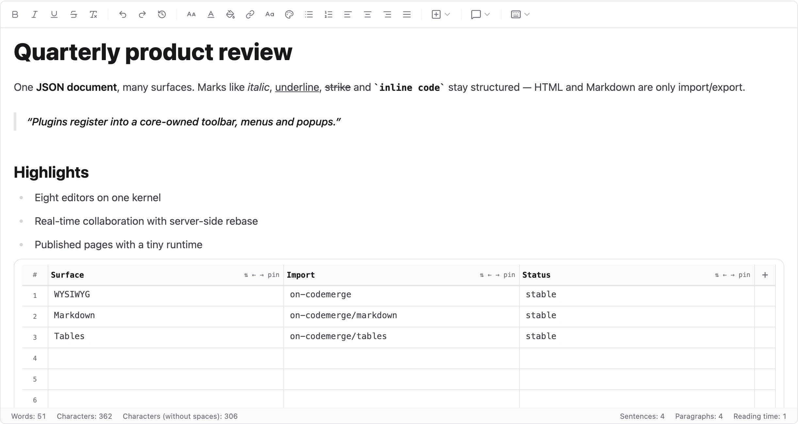
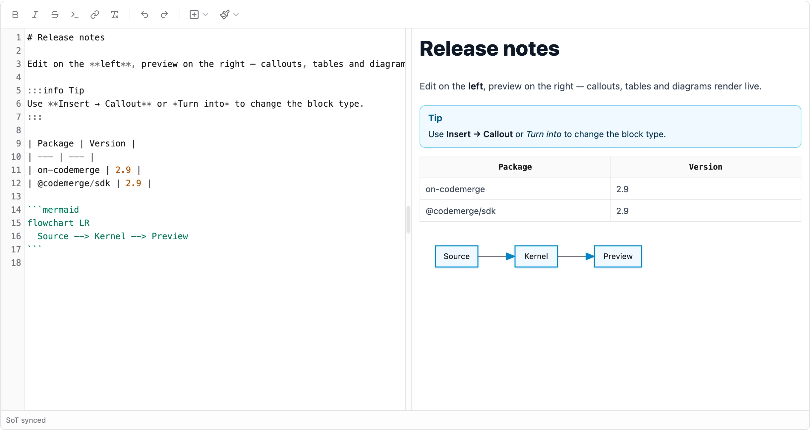
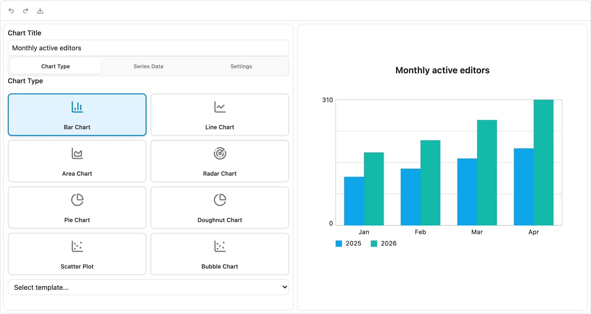
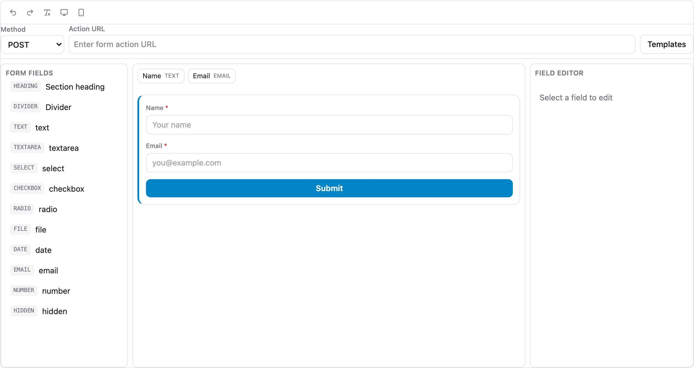
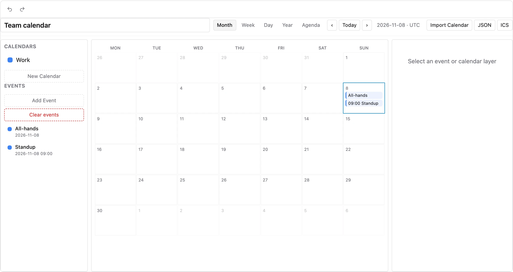
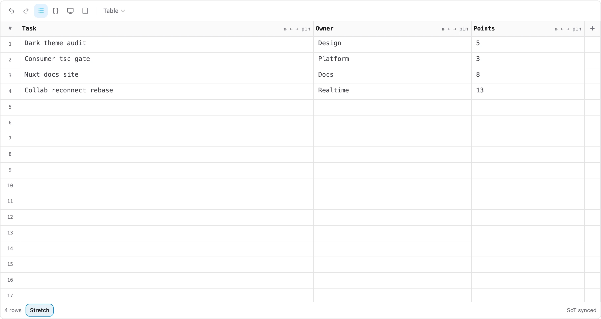
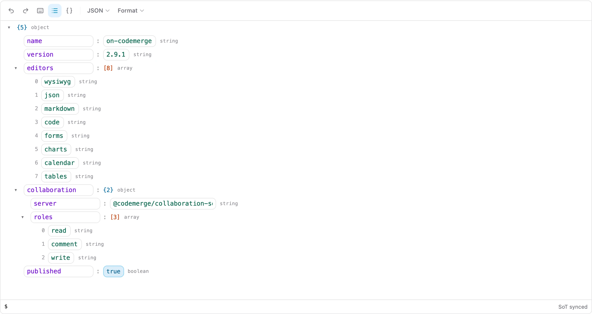

[](https://www.npmjs.com/package/on-codemerge)
[](https://www.npmjs.com/package/on-codemerge)
[](https://github.com/s00d/on-codemerge/blob/main/LICENSE)
[](https://www.npmjs.com/package/on-codemerge)
[](https://s00d.github.io/on-codemerge/)
[](https://www.donationalerts.com/r/s00d88)

<p align="center">
  
</p>

# on-codemerge

**Eight document editors on one JSON kernel.** WYSIWYG, Markdown, JSON, Code, Forms, Charts,
Calendar and Tables share one document model, one undo history and one plugin SDK. Toolbar, menus
and popups belong to the core; features are plugins you opt into. Mount it in plain HTML or any
framework, light or dark.

[Documentation](https://s00d.github.io/on-codemerge/) ·
[Live demos](https://s00d.github.io/on-codemerge/) ·
[Editors](https://s00d.github.io/on-codemerge/getting-started/editors) ·
[Plugins](https://s00d.github.io/on-codemerge/plugins/overview) ·
[Integrate](https://s00d.github.io/on-codemerge/integrate/overview) ·
[Changelog](https://s00d.github.io/on-codemerge/changelog)

<picture>
  <source media="(prefers-color-scheme: dark)" srcset="https://raw.githubusercontent.com/s00d/on-codemerge/main/branding/screenshots/wysiwyg-dark.webp">
  
</picture>

## Editors

| Editor       | Import                  | Document                     | UI                                  |
| ------------ | ----------------------- | ---------------------------- | ----------------------------------- |
| **WYSIWYG**  | `on-codemerge`          | Prose JSON (marks, atoms, …) | ContentEditable + widgets           |
| **Markdown** | `on-codemerge/markdown` | Prose JSON (Markdown subset) | Source + live preview               |
| **JSON**     | `on-codemerge/json`     | JSON tree                    | Tree / Raw                          |
| **Code**     | `on-codemerge/code`     | Plain text                   | Gutter + structural highlight       |
| **Forms**    | `on-codemerge/forms`    | Form config                  | Palette, live form, field inspector |
| **Charts**   | `on-codemerge/charts`   | Chart attrs                  | Type, data, settings + live preview |
| **Calendar** | `on-codemerge/calendar` | Calendar doc (+ ICS)         | Month / week / day / year / agenda  |
| **Tables**   | `on-codemerge/tables`   | Grid doc                     | Typed columns, sort, filter, resize |

<table>
  <tr>
    <td width="50%">
      <picture>
        <source media="(prefers-color-scheme: dark)" srcset="https://raw.githubusercontent.com/s00d/on-codemerge/main/branding/screenshots/markdown-dark.webp">
        
      </picture>
      <p align="center"><b>Markdown</b>: callouts, tables, mermaid</p>
    </td>
    <td width="50%">
      <picture>
        <source media="(prefers-color-scheme: dark)" srcset="https://raw.githubusercontent.com/s00d/on-codemerge/main/branding/screenshots/charts-dark.webp">
        
      </picture>
      <p align="center"><b>Charts</b>: studio + live preview</p>
    </td>
  </tr>
  <tr>
    <td width="50%">
      <picture>
        <source media="(prefers-color-scheme: dark)" srcset="https://raw.githubusercontent.com/s00d/on-codemerge/main/branding/screenshots/forms-dark.webp">
        
      </picture>
      <p align="center"><b>Forms</b>: builder + inspector</p>
    </td>
    <td width="50%">
      <picture>
        <source media="(prefers-color-scheme: dark)" srcset="https://raw.githubusercontent.com/s00d/on-codemerge/main/branding/screenshots/calendar-dark.webp">
        
      </picture>
      <p align="center"><b>Calendar</b>: layers, views, ICS</p>
    </td>
  </tr>
  <tr>
    <td width="50%">
      <picture>
        <source media="(prefers-color-scheme: dark)" srcset="https://raw.githubusercontent.com/s00d/on-codemerge/main/branding/screenshots/tables-dark.webp">
        
      </picture>
      <p align="center"><b>Tables</b>: typed grid</p>
    </td>
    <td width="50%">
      <picture>
        <source media="(prefers-color-scheme: dark)" srcset="https://raw.githubusercontent.com/s00d/on-codemerge/main/branding/screenshots/json-dark.webp">
        
      </picture>
      <p align="center"><b>JSON</b>: tree / raw</p>
    </td>
  </tr>
</table>

## Features

- **One document model**: `getJSON` / `setJSON` is the source of truth; HTML and Markdown are import/export
- **40 plugins** in groups (formatting, blocks, media, data, collaboration, tools); `createDefaultPlugins()` or a lean `createCorePlugins()`
- **Core-owned UI**: `editor.toolbar`, `editor.ui.popup`, context menu, notify; plugins only register
- **Collaboration**: [`@codemerge/collaboration-server`](./packages/collaboration-server) with server-side rebase, roles, comments and offline edits replayed on reconnect
- **Published pages**: `getPublishedHTML()` + `on-codemerge/public.css` / `public.js`
- **Light and dark**: the host owns `html.dark`; tokens, charts and diagrams follow it
- **Any host**: [`@codemerge/integrate`](./packages/integrate) adapters for React, Vue, Svelte, Angular, jQuery, `<ocm-editor>`, plus recipes for 60+ stacks
- **i18n**: lazy locale packs (`en` bundled; `ru`, `de`, `fr`, … on demand)
- **Typed**: ESM + CJS with `.d.ts` / `.d.cts`; checked with attw and a consumer `tsc` under `nodenext` and `bundler`

## Install

```bash
pnpm add on-codemerge
# npm install on-codemerge · yarn add on-codemerge · bun add on-codemerge
```

## Quick start

```ts
import 'on-codemerge/index.css';
import 'on-codemerge/public.css';
import { Editor, createDefaultPlugins } from 'on-codemerge';

const editor = new Editor(document.getElementById('editor')!, {
  plugins: createDefaultPlugins(),
});

editor.setHTML('<h1>Hello</h1><p>Edit me.</p>');
editor.on('docChanged', () => save(editor.getJSON()));
```

Every other editor mounts the same way from its subpath and exchanges plain text:

```ts
import { Editor, createDefaultPlugins } from 'on-codemerge/markdown'; // or /json, /code, /forms, …

const md = new Editor(document.getElementById('md')!, { plugins: createDefaultPlugins() });
md.setText('# Hello\n');
```

Dark mode: add `class="dark"` to `<html>` (or pass `colorScheme: 'system'` to follow the OS).

Framework adapters:

```tsx
import { CodeMergeEditor } from '@codemerge/integrate/react';

<CodeMergeEditor value={html} format="html" onChange={setHtml} />;
```

More: [Editor API](https://s00d.github.io/on-codemerge/getting-started/editor-api) ·
[Editors](https://s00d.github.io/on-codemerge/getting-started/editors) ·
[Integrate](https://s00d.github.io/on-codemerge/integrate/overview) ·
[Migration v1 → v2](https://s00d.github.io/on-codemerge/getting-started/migration-v1-to-v2)

## Packages

| Package                                                              | Role                                                            |
| -------------------------------------------------------------------- | --------------------------------------------------------------- |
| [`on-codemerge`](https://www.npmjs.com/package/on-codemerge)         | All eight editors, plugins, CSS, published-page runtime         |
| [`@codemerge/integrate`](./packages/integrate)                       | Framework adapters, `<ocm-editor>`, persistence + native bridge |
| [`@codemerge/collaboration-server`](./packages/collaboration-server) | Authoritative WebSocket + REST collaboration server             |
| [`@codemerge/sdk`](./packages/sdk)                                   | Plugin API and chrome, for plugins built outside the monolith   |
| [`@codemerge/kernel`](./packages/kernel)                             | Headless document model, ops, transforms                        |
| [`@codemerge/view`](./packages/view)                                 | Zero-dependency ViewSpec DOM runtime                            |
| [`@codemerge/mermaid`](./packages/mermaid)                           | Sync Mermaid-subset → SVG                                       |
| [`@codemerge/hunspell`](./packages/hunspell)                         | Hunspell `.aff` / `.dic` spell engine                           |

Most apps need only `on-codemerge`. Do not bundle `on-codemerge` and `@codemerge/sdk` into one app
(duplicate SDK/kernel instances).

## Develop

This repo is **pnpm-only**.

```bash
pnpm install
pnpm dev              # editor playground
pnpm docs:dev         # docs site (Nuxt) with live demos
pnpm run check        # format, lint, typecheck, locales, collab tests
pnpm test:unit && pnpm test:e2e
```

[`demo/`](./demo) is a stand against the **published** packages (`pnpm typecheck`, `pnpm test:e2e`,
`pnpm screenshots` for the images above). Release flow: [Publishing packages](https://s00d.github.io/on-codemerge/architecture/publishing-packages).

## License

[MIT](./LICENSE)
